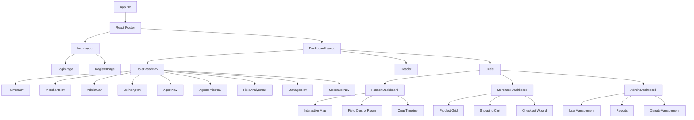

# FarmConnect AgriManagement - Client-Side Project Structure

## Executive Summary

This document outlines the comprehensive client-side architecture for the FarmConnect AgriManagement platform, a React + TypeScript application serving 9 distinct user roles with complex agricultural management features. The architecture is designed to address key constraints: rural connectivity (offline-first), multi-language support, varying device capabilities, outdoor usage scenarios, and diverse technical literacy levels.

## Technology Stack

- **Framework**: React 18+ with TypeScript 5.x
- **Build Tool**: Vite 5.x (for fast builds and optimized production bundles)
- **State Management**: Zustand (lightweight, TypeScript-friendly)
- **Routing**: React Router v6 with lazy loading
- **HTTP Client**: Axios with interceptors for auth/error handling
- **Forms**: React Hook Form + Zod validation
- **Maps**: Leaflet (lightweight, offline-capable)
- **UI Components**: Custom design system with accessibility focus
- **Offline Support**: Workbox for service worker, IndexedDB for local persistence
- **i18n**: react-i18next for internationalization

---

## 1. Project Root Structure

```
frontend/
├── public/
│   ├── locales/              # Translation JSON files
│   │   ├── en/
│   │   ├── am/              # Amharic
│   │   └── om/              # Oromiffa
│   ├── icons/               # Favicon, PWA icons
│   ├── images/
│   │   ├── placeholders/    # Default images for offline fallback
│   │   └── illustrations/   # Onboarding illustrations
│   ├── sounds/              # Audio for guided tour/voiceovers
│   └── manifest.json        # PWA manifest
├── src/
│   ├── main.tsx             # Application entry point
│   ├── App.tsx              # Root component with router
│   ├── vite-env.d.ts        # Vite type definitions
│   └── react-app-env.d.ts   # React type definitions
├── package.json
├── tsconfig.json
├── tsconfig.node.json
├── vite.config.ts
├── index.html
└── .env.example
```

### Rationale
- **public/locales/**: Supports Amharic and Oromiffa for Ethiopian rural users
- **public/images/placeholders/**: Essential for offline-first - users can still see UI when images fail to load
- **public/sounds/**: Audio voiceovers support users with lower literacy (per UI/UX decisions)

---

## 2. Core Application Architecture

### 2.1 Source Directory Structure

```
src/
├── main.tsx
├── App.tsx
├── app/
│   ├── store/               # Global state management
│   │   ├── index.ts        # Store configuration
│   │   ├── useAuthStore.ts # Authentication state
│   │   ├── useFarmStore.ts # Farm/field data
│   │   ├── useCartStore.ts # Shopping cart
│   │   └── useUIStore.ts   # UI preferences (theme, language)
│   ├── router/             # Routing configuration
│   │   ├── index.tsx       # Main router with lazy loading
│   │   ├── routes.ts       # Route definitions
│   │   ├── guards.ts       # Route protection (RBAC)
│   │   └── transforms.ts   # Route data transforms
│   ├── services/           # API service layer
│   │   ├── api.ts          # Axios instance configuration
│   │   ├── interceptors/   # Request/response interceptors
│   │   │   ├── auth.ts     # Token injection
│   │   │   ├── error.ts    # Global error handling
│   │   │   └── offline.ts  # Offline queue management
│   │   ├── auth.service.ts
│   │   ├── farms.service.ts
│   │   ├── fields.service.ts
│   │   ├── crops.service.ts
│   │   ├── harvests.service.ts
│   │   ├── products.service.ts
│   │   ├── orders.service.ts
│   │   ├── delivery.service.ts
│   │   ├── payments.service.ts
│   │   ├── weather.service.ts
│   │   ├── ai-diagnosis.service.ts
│   │   ├── monitoring.service.ts
│   │   ├── disputes.service.ts
│   │   ├── users.service.ts
│   │   ├── reports.service.ts
│   │   └── accounting.service.ts
│   ├── hooks/              # Custom React hooks
│   │   ├── useAuth.ts
│   │   ├── useOffline.ts
│   │   ├── useDebounce.ts
│   │   ├── useLocalStorage.ts
│   │   ├── usePagination.ts
│   │   └── index.ts
│   ├── i18n/               # Internationalization
│   │   ├── index.ts        # i18n configuration
│   │   ├── config.ts       # Language settings
│   │   └── translations/   # Translation utilities
│   └── config/             # Application configuration
│       ├── constants.ts
│       ├── endpoints.ts
│       └── roles.ts
├── features/               # Feature-based modules (domain-driven)
│   ├── auth/
│   │   ├── components/
│   │   │   ├── LoginForm.tsx
│   │   │   ├── RegisterForm.tsx
│   │   │   ├── RoleSelector.tsx
│   │   │   ├── GuidedTour.tsx
│   │   │   ├── PasswordReset.tsx
│   │   │   └── KeycloakCallback.tsx
│   │   ├── hooks/
│   │   │   ├── useLogin.ts
│   │   │   ├── useRegister.ts
│   │   │   └── useKeycloak.ts
│   │   ├── utils/
│   │   │   └── tokenUtils.ts
│   │   └── types/
│   │       └── auth.types.ts
│   ├── farms/
│   │   ├── components/
│   │   │   ├── FarmMap.tsx
│   │   │   ├── FarmCard.tsx
│   │   │   ├── FarmForm.tsx
│   │   │   ├── FarmStats.tsx
│   │   │   ├── FarmSettings.tsx
│   │   │   └── FarmList.tsx
│   │   ├── hooks/
│   │   │   ├── useFarms.ts
│   │   │   └── useFarmMetrics.ts
│   │   └── types/
│   │       └── farm.types.ts
│   ├── fields/
│   │   ├── components/
│   │   │   ├── FieldMap.tsx          # Tap-and-draw satellite interface
│   │   │   ├── FieldCard.tsx
│   │   │   ├── FieldControlRoom.tsx  # Field detail dashboard
│   │   │   ├── FieldList.tsx
│   │   │   ├── FieldBoundaryEditor.tsx
│   │   │   └── CropColorLegend.tsx
│   │   ├── hooks/
│   │   │   ├── useFields.ts
│   │   │   └── useFieldBoundary.ts
│   │   └── types/
│   │       └── field.types.ts
│   ├── crops/
│   │   ├── components/
│   │   │   ├── CropCycleTimeline.tsx  # Vertical activity feed
│   │   │   ├── CropCycleCard.tsx
│   │   │   ├── CropCycleForm.tsx      # Blank canvas for new cycles
│   │   │   ├── StageTransitionModal.tsx
│   │   │   ├── GrowthStageIndicator.tsx
│   │   │   └── TaskList.tsx
│   │   ├── hooks/
│   │   │   ├── useCropCycles.ts
│   │   │   └── useStageTransition.ts
│   │   └── types/
│   │       └── crop.types.ts
│   ├── harvests/
│   │   ├── components/
│   │   │   ├── HarvestCalendar.tsx    # Calendar view scheduler
│   │   │   ├── HarvestLogForm.tsx    # End-of-day log
│   │   │   ├── YieldEntryForm.tsx
│   │   │   ├── HarvestCard.tsx
│   │   │   └── HarvestQueue.tsx
│   │   ├── hooks/
│   │   │   └── useHarvests.ts
│   │   └── types/
│   │       └── harvest.types.ts
│   ├── products/
│   │   ├── components/
│   │   │   ├── ProductGrid.tsx       # Farm-to-table visual grid
│   │   │   ├── ProductCard.tsx
│   │   │   ├── ProductDetail.tsx
│   │   │   ├── ProductFilters.tsx
│   │   │   ├── InventoryFunnel.tsx   # Farmer inventory view
│   │   │   ├── ProductForm.tsx
│   │   │   ├── BatchQCAssessment.tsx
│   │   │   └── CategoryNav.tsx
│   │   ├── hooks/
│   │   │   └── useProducts.ts
│   │   └── types/
│   │       └── product.types.ts
│   ├── orders/
│   │   ├── components/
│   │   │   ├── Cart.tsx
│   │   │   ├── CartItem.tsx
│   │   │   ├── CheckoutWizard.tsx
│   │   │   ├── OrderSummary.tsx
│   │   │   ├── OrderCard.tsx
│   │   │   ├── OrderTimeline.tsx
│   │   │   ├── OrderInbox.tsx        # Farmer action-required inbox
│   │   │   ├── PaymentForm.tsx
│   │   │   ├── StockConflictModal.tsx
│   │   │   └── EscrowStatus.tsx
│   │   ├── hooks/
│   │   │   ├── useCart.ts
│   │   │   ├── useCheckout.ts
│   │   │   └── useOrders.ts
│   │   └── types/
│   │       └── order.types.ts
│   ├── delivery/
│   │   ├── components/
│   │   │   ├── DeliveryMap.tsx        # Ride-hailing style map
│   │   │   ├── DeliveryJobCard.tsx
│   │   │   ├── DeliveryTracking.tsx
│   │   │   ├── QRCodeScanner.tsx     # Handover protocol
│   │   │   ├── QRCodeDisplay.tsx
│   │   │   ├── DriverStatus.tsx
│   │   │   └── MilestoneTracker.tsx
│   │   ├── hooks/
│   │   │   └── useDelivery.ts
│   │   └── types/
│   │       └── delivery.types.ts
│   ├── ai-diagnosis/
│   │   ├── components/
│   │   │   ├── ImageUploader.tsx     # Upload & annotate flow
│   │   │   ├── AnnotationCanvas.tsx
│   │   │   ├── DiagnosisResult.tsx  # Differential diagnosis display
│   │   │   ├── RecommendationCard.tsx
│   │   │   └── EscalateButton.tsx
│   │   ├── hooks/
│   │   │   └── useDiagnosis.ts
│   │   └── types/
│   │       └── diagnosis.types.ts
│   ├── weather/
│   │   ├── components/
│   │   │   ├── WeatherWidget.tsx     # Minimalist SMS/widget
│   │   │   ├── WeatherAlert.tsx
│   │   │   ├── HistoricalWeather.tsx
│   │   │   └── WeatherReport.tsx     # PDF post-mortem
│   │   ├── hooks/
│   │   │   └── useWeather.ts
│   │   └── types/
│   │       └── weather.types.ts
│   ├── monitoring/
│   │   ├── components/
│   │   │   ├── NDVIGraph.tsx         # Vigor trend graph
│   │   │   ├── SensorDataPanel.tsx
│   │   │   ├── AlertList.tsx
│   │   │   └── ObservationForm.tsx
│   │   ├── hooks/
│   │   │   └── useMonitoring.ts
│   │   └── types/
│   │       └── monitoring.types.ts
│   ├── disputes/
│   │   ├── components/
│   │   │   ├── DisputeForm.tsx
│   │   │   ├── DisputeCard.tsx
│   │   │   ├── AgentChat.tsx         # Mediation flow
│   │   │   ├── EvidenceUpload.tsx
│   │   │   └── ResolutionPanel.tsx
│   │   ├── hooks/
│   │   │   └── useDisputes.ts
│   │   └── types/
│   │       └── dispute.types.ts
│   ├── users/
│   │   ├── components/
│   │   │   ├── UserList.tsx
│   │   │   ├── UserCard.tsx
│   │   │   ├── UserDetail.tsx
│   │   │   ├── UserForm.tsx
│   │   │   └── RoleBadge.tsx
│   │   ├── hooks/
│   │   │   └── useUsers.ts
│   │   └── types/
│   │       └── user.types.ts
│   ├── reports/
│   │   ├── components/
│   │   │   ├── ReportDashboard.tsx
│   │   │   ├── ReportCard.tsx
│   │   │   ├── DateRangePicker.tsx
│   │   │   ├── ChartContainer.tsx
│   │   │   ├── ExportButtons.tsx
│   │   │   └── PDFViewer.tsx
│   │   ├── hooks/
│   │   │   └── useReports.ts
│   │   └── types/
│   │       └── report.types.ts
│   └── accounting/
│       ├── components/
│       │   ├── BalanceDisplay.tsx
│       │   ├── TransactionList.tsx
│       │   ├── EscrowStatus.tsx
│       │   ├── JournalEntry.tsx
│       │   └── StatementViewer.tsx
│       ├── hooks/
│       │   └── useAccounting.ts
│       └── types/
│           └── accounting.types.ts
├── shared/                    # Shared components and utilities
│   ├── components/
│   │   ├── ui/               # Base UI components (design system)
│   │   │   ├── Button.tsx
│   │   │   ├── Input.tsx
│   │   │   ├── Select.tsx
│   │   │   ├── Modal.tsx
│   │   │   ├── Card.tsx
│   │   │   ├── Badge.tsx
│   │   │   ├── Avatar.tsx
│   │   │   ├── LoadingSpinner.tsx
│   │   │   ├── Skeleton.tsx
│   │   │   ├── Toast.tsx
│   │   │   ├── Alert.tsx
│   │   │   ├── Tabs.tsx
│   │   │   ├── Accordion.tsx
│   │   │   ├── DatePicker.tsx
│   │   │   ├── FileUpload.tsx
│   │   │   ├── CameraCapture.tsx
│   │   │   ├── QRCode.tsx
│   │   │   └── BottomSheet.tsx     # Progressive bottom sheet
│   │   ├── layout/
│   │   │   ├── AppLayout.tsx
│   │   │   ├── AuthLayout.tsx
│   │   │   ├── DashboardLayout.tsx
│   │   │   ├── MobileNav.tsx
│   │   │   ├── Sidebar.tsx
│   │   │   ├── Header.tsx
│   │   │   ├── Footer.tsx
│   │   │   ├── RoleBasedNav.tsx
│   │   │   └── OfflineIndicator.tsx
│   │   ├── forms/
│   │   │   ├── FormField.tsx
│   │   │   ├── FormError.tsx
│   │   │   ├── FormActions.tsx
│   │   │   └── AutoSaveIndicator.tsx
│   │   ├── data/
│   │   │   ├── CountrySelect.tsx
│   │   │   ├── RegionSelect.tsx
│   │   │   ├── CropSelect.tsx
│   │   │   └── SoilTypeSelect.tsx
│   │   ├── maps/
│   │   │   ├── BaseMap.tsx
│   │   │   ├── MapMarker.tsx
│   │   │   ├── MapPopup.tsx
│   │   │   ├── DrawControl.tsx
│   │   │   ├── SatelliteLayer.tsx
│   │   │   └── GeoJSONLayer.tsx
│   │   ├── feedback/
│   │   │   ├── LoadingOverlay.tsx
│   │   │   ├── EmptyState.tsx
│   │   │   ├── ErrorBoundary.tsx
│   │   │   ├── NetworkStatus.tsx
│   │   │   └── SyncStatus.tsx
│   │   └── accessibility/
│   │       ├── ScreenReaderOnly.tsx
│   │       ├── FocusTrap.tsx
│   │       └── HighContrastToggle.tsx
│   ├── hooks/
│   │   ├── useCommon.ts
│   │   └── index.ts
│   ├── utils/
│   │   ├── validation.ts          # Zod schemas
│   │   ├── formatting.ts          # Date, number, currency formatters
│   │   ├── geoJSON.ts             # GeoJSON utilities
│   │   ├── offline.ts             # IndexedDB helpers
│   │   ├── permissions.ts         # RBAC utilities
│   │   └── constants.ts
│   ├── types/                     # Shared TypeScript types
│   │   └── index.ts              # Re-exports from shared/ts
│   └── constants/
│       ├── colors.ts              # Crop color coding
│       └── routes.ts
├── pages/                         # Page components (route targets)
│   ├── Landing.tsx
│   ├── NotFound.tsx
│   ├── Unauthorized.tsx
│   ├── Maintenance.tsx
│   └── roles/                     # Role-specific pages
│       ├── farmer/
│       │   ├── FarmerDashboard.tsx
│       │   ├── FarmCreation.tsx
│       │   ├── FieldDetail.tsx
│       │   ├── CropCycleDetail.tsx
│       │   ├── HarvestSchedule.tsx
│       │   ├── InventoryManagement.tsx
│       │   ├── AIMobileScanner.tsx
│       │   ├── FarmSettingsPage.tsx
│       │   └── Profile.tsx
│       ├── merchant/
│       │   ├── MerchantDashboard.tsx
│       │   ├── Marketplace.tsx
│       │   ├── ProductDetail.tsx
│       │   ├── CartPage.tsx
│       │   ├── CheckoutPage.tsx
│       │   ├── OrderConfirmation.tsx
│       │   ├── OrderHistory.tsx
│       │   └── Profile.tsx
│       ├── delivery/
│       │   ├── DeliveryDashboard.tsx
│       │   ├── AvailableJobs.tsx
│       │   ├── ActiveDelivery.tsx
│       │   └── DeliveryHistory.tsx
│       ├── agent/
│       │   ├── AgentDashboard.tsx
│       │   ├── AssignedTasks.tsx
│       │   └── MediationQueue.tsx
│       ├── agronomist/
│       │   ├── AgronomistDashboard.tsx
│       │   ├── AdvisoryTickets.tsx
│       │   ├── DiagnosisReview.tsx
│       │   └── FieldVisits.tsx
│       ├── field-analyst/
│       │   ├── AnalystDashboard.tsx
│       │   ├── DataEntry.tsx
│       │   └── Reports.tsx
│       ├── manager/
│       │   ├── ManagerDashboard.tsx
│       │   ├── TeamOverview.tsx
│       │   └── RegionAnalytics.tsx
│       ├── admin/
│       │   ├── AdminDashboard.tsx
│       │   ├── UserManagement.tsx
│       │   ├── SystemConfig.tsx
│       │   ├── Reports.tsx
│       │   └── AuditLogs.tsx
│       └── moderator/
│           ├── ModeratorDashboard.tsx
│           ├── ContentReview.tsx
│           └── DisputeQueue.tsx
├── workers/                      # Service workers
│   ├── sw.ts                     # Main service worker
│   ├── sw-dev.ts                 # Development service worker
│   └── /// <reference types="vite-plugin-pwa/workbox" />
└── styles/
    ├── globals.css              # Global styles, CSS variables
    ├── themes.css               # Theme definitions
    └── animations.css           # Animation utilities
```

### Rationale
- **Feature-based folders**: Each domain (farms, fields, orders) is a self-contained module with its own components, hooks, and types
- **Shared components**: UI primitives in `shared/components/ui` form a design system
- **Role-based pages**: Each role gets its own folder under `pages/roles/`
- **Offline-first**: Service workers and IndexedDB utilities enable offline functionality

---

## 3. Role-Based Access Control (RBAC) Architecture

### 3.1 Role Definitions

```typescript
// src/config/roles.ts

export enum UserRole {
  FARMER = 'FARMER',
  MERCHANT = 'MERCHANT',
  DELIVERY = 'DELIVERY',
  AGENT = 'AGENT',
  MANAGER = 'MANAGER',
  ADMIN = 'ADMIN',
  MODERATOR = 'MODERATOR',
  AGRONOMIST = 'AGRONOMIST',
  FIELD_ANALYST = 'FIELD_ANALYST',
}

// Role hierarchy for permission inheritance
export const ROLE_HIERARCHY: Record<UserRole, UserRole[]> = {
  [UserRole.ADMIN]: [UserRole.ADMIN, UserRole.MANAGER, UserRole.MODERATOR],
  [UserRole.MANAGER]: [UserRole.MANAGER, UserRole.AGRONOMIST, UserRole.AGENT],
  [UserRole.MODERATOR]: [UserRole.MODERATOR, UserRole.AGENT],
  [UserRole.AGRONOMIST]: [UserRole.AGRONOMIST, UserRole.FIELD_ANALYST],
  // ... etc
};

// Permission matrix
export const PERMISSIONS = {
  // Farms
  'farm:create': [UserRole.FARMER],
  'farm:read:own': [UserRole.FARMER],
  'farm:read:all': [UserRole.ADMIN, UserRole.MANAGER, UserRole.AGRONOMIST],
  'farm:update:own': [UserRole.FARMER],
  'farm:delete': [UserRole.FARMER, UserRole.ADMIN],
  
  // Orders
  'order:create': [UserRole.MERCHANT],
  'order:read:own': [UserRole.MERCHANT, UserRole.FARMER],
  'order:manage': [UserRole.ADMIN, UserRole.AGENT],
  
  // Delivery
  'delivery:accept': [UserRole.DELIVERY],
  'delivery:track': [UserRole.MERCHANT, UserRole.FARMER],
  
  // AI Diagnosis
  'diagnosis:create': [UserRole.FARMER, UserRole.AGRONOMIST],
  'diagnosis:review': [UserRole.AGRONOMIST],
  
  // Users
  'user:create': [UserRole.ADMIN],
  'user:read': [UserRole.ADMIN, UserRole.MANAGER],
  'user:update': [UserRole.ADMIN, UserRole.MANAGER],
  'user:delete': [UserRole.ADMIN],
  
  // Reports
  'reports:read:own': [UserRole.FARMER, UserRole.MERCHANT],
  'reports:read:region': [UserRole.MANAGER, UserRole.AGRONOMIST],
  'reports:read:all': [UserRole.ADMIN],
  
  // Disputes
  'dispute:create': [UserRole.MERCHANT, UserRole.FARMER],
  'dispute:resolve': [UserRole.ADMIN, UserRole.MODERATOR, UserRole.AGENT],
} as const;
```

### 3.2 Route Guards

```typescript
// src/app/router/guards.ts

interface RouteGuardConfig {
  requireAuth: boolean;
  allowedRoles?: UserRole[];
  requiredPermissions?: string[];
}

export const routeGuards: Record<string, RouteGuardConfig> = {
  '/dashboard': { requireAuth: true },
  '/farms': { requireAuth: true, allowedRoles: [UserRole.FARMER] },
  '/marketplace': { requireAuth: true, allowedRoles: [UserRole.MERCHANT] },
  '/admin': { requireAuth: true, allowedRoles: [UserRole.ADMIN] },
  '/users': { requireAuth: true, allowedRoles: [UserRole.ADMIN, UserRole.MANAGER] },
  '/reports': { requireAuth: true },
  '/delivery': { requireAuth: true, allowedRoles: [UserRole.DELIVERY] },
};
```

---

## 4. State Management Architecture

### 4.1 Store Structure (Zustand)

```typescript
// src/app/store/useAuthStore.ts

interface AuthState {
  user: User | null;
  token: string | null;
  refreshToken: string | null;
  isAuthenticated: boolean;
  isLoading: boolean;
  error: string | null;
  
  // Actions
  login: (credentials: LoginCredentials) => Promise<void>;
  logout: () => void;
  refreshAuth: () => Promise<void>;
  clearError: () => void;
}
```

### 4.2 Offline Data Store

```typescript
// For offline-first: Use IndexedDB via idb-keyval or Dexie
// Separate stores for:
// - Pending actions (orders, observations) to sync when online
// - Cached data (farms, products) for offline access
// - User preferences (language, theme)
```

---

## 5. API Service Layer

### 5.1 Axios Configuration

```typescript
// src/app/services/api.ts

const api = axios.create({
  baseURL: import.meta.env.VITE_API_URL,
  timeout: 30000, // Longer timeout for rural connectivity
  headers: {
    'Content-Type': 'application/json',
  },
});

// Request interceptor: Add auth token
// Response interceptor: Handle 401, queue offline requests
// Error interceptor: Transform API errors to user-friendly messages
```

### 5.2 Service Pattern

```typescript
// src/app/services/farms.service.ts

export const farmsService = {
  list: (params: FarmListParams) => 
    api.get<PaginatedResponse<Farm>>('/api/v1/farms', { params }),
  
  getById: (id: string) =>
    api.get<Farm>(`/api/v1/farms/${id}`),
  
  create: (data: FarmCreate) =>
    api.post<Farm>('/api/v1/farms', data),
  
  update: (id: string, data: FarmUpdate) =>
    api.patch<Farm>(`/api/v1/farms/${id}`, data),
  
  delete: (id: string) =>
    api.delete(`/api/v1/farms/${id}`),
};
```

---

## 6. Form Validation Strategy

### 6.1 Zod Schemas

```typescript
// src/shared/utils/validation.ts

import { z } from 'zod';

export const farmCreateSchema = z.object({
  name: z.string().min(1).max(100),
  location_lat: z.string().regex(/^-?\d+\.?\d*$/),
  location_lng: z.string().regex(/^-?\d+\.?\d*$/),
  location_address: z.string().optional(),
  total_area_ha: z.string().optional(),
  boundary_geojson: geoJSONSchema.optional(),
});

export const loginSchema = z.object({
  email: z.string().email(),
  password: z.string().min(8),
});
```

### 6.2 React Hook Form Integration

```typescript
// Uses react-hook-form with zod resolver
// Auto-save drafts to localStorage for rural users
// Optimistic updates with rollback on failure
```

---

## 7. Loading States & User Feedback

### 7.1 Global Loading Strategy

```typescript
// Loading states per component:
// - Skeleton loaders for initial data load
// - Spinner for inline loading
// - Progress bar for file uploads
// - Toast notifications for success/error
```

### 7.2 Offline Indicators

```typescript
// Components:
// - NetworkStatus: Shows online/offline state
// - OfflineIndicator: Persistent banner when offline
// - SyncStatus: Shows pending sync items count
// - Auto-retry: Queue actions and retry when online
```

---

## 8. Accessibility & Outdoor Usage

### 8.1 High Contrast Mode

```css
/* Outdoor visibility: High contrast themes */
.theme-high-contrast {
  --bg-primary: #000000;
  --bg-secondary: #1a1a1a;
  --text-primary: #ffffff;
  --text-secondary: #ffff00;
  --border-color: #ffffff;
  --focus-ring: 4px solid #ffff00;
}
```

### 8.2 Large Touch Targets

```css
/* Minimum 48px touch targets for field usage */
.touch-target {
  min-height: 48px;
  min-width: 48px;
  padding: 12px 16px;
}
```

### 8.3 Screen Reader Support

```typescript
// ARIA labels on all interactive elements
// Focus management for modals
// Live regions for dynamic content (orders, alerts)
// Skip navigation links
```

---

## 9. Component Hierarchy Diagram



---

## 10. API Endpoint Mapping

| Backend Route | Frontend Service | Feature |
|--------------|------------------|---------|
| `/api/v1/auth/*` | `auth.service.ts` | Authentication |
| `/api/v1/farms/*` | `farms.service.ts` | Farm Management |
| `/api/v1/fields/*` | `fields.service.ts` | Field Management |
| `/api/v1/crops/*` | `crops.service.ts` | Crop Cycles |
| `/api/v1/harvests/*` | `harvests.service.ts` | Harvest Planning |
| `/api/v1/products/*` | `products.service.ts` | Product Catalog |
| `/api/v1/orders/*` | `orders.service.ts` | Order Processing |
| `/api/v1/delivery/*` | `delivery.service.ts` | Delivery Logistics |
| `/api/v1/ai/*` | `ai-diagnosis.service.ts` | Disease Diagnosis |
| `/api/v1/weather/*` | `weather.service.ts` | Weather Integration |
| `/api/v1/monitoring/*` | `monitoring.service.ts` | Field Monitoring |
| `/api/v1/disputes/*` | `disputes.service.ts` | Dispute Resolution |
| `/api/v1/users/*` | `users.service.ts` | User Management |
| `/api/v1/reports/*` | `reports.service.ts` | Analytics & Reports |
| `/api/v1/accounting/*` | `accounting.service.ts` | Financial Management |

---

## 11. Implementation Priority

### Phase 1: Core Infrastructure
1. Project setup (Vite, TypeScript, React Router)
2. Design system (UI components)
3. Authentication (Keycloak integration)
4. Role-based routing

### Phase 2: Farmer Features
5. Farm & Field management
6. Crop lifecycle tracking
7. Harvest planning
8. AI disease diagnosis

### Phase 3: Merchant Features
9. Product catalog & marketplace
10. Shopping cart & checkout
11. Order management

### Phase 4: Delivery & Operations
12. Delivery logistics
13. Dispute resolution
14. Admin dashboards

### Phase 5: Advanced Features
15. Offline-first support
16. Multi-language (Amharic, Oromiffa)
17. Accessibility enhancements

---

## 12. Key Architectural Decisions

| Decision | Rationale |
|----------|-----------|
| Zustand over Redux | Lighter bundle, better TypeScript support |
| React Router v6 | Standard routing with nested routes |
| Axios over fetch | Better interceptors, timeout handling |
| Zod for validation | TypeScript-native, composable schemas |
| Leaflet for maps | Lightweight, offline tile caching |
| Service Worker | Offline-first capability |
| Lazy loading | Code splitting for large bundles |

---

## 13. File Naming Conventions

- **Components**: `PascalCase.tsx` (e.g., `FarmMap.tsx`)
- **Hooks**: `camelCase.ts` with `use` prefix (e.g., `useFarms.ts`)
- **Services**: `camelCase.service.ts` (e.g., `farms.service.ts`)
- **Types**: `kebab-case.types.ts` or feature `types.ts`
- **Utilities**: `camelCase.ts` (e.g., `validation.ts`)
- **Styles**: `kebab-case.css` or `kebab-case.module.css`

---

## 14. Integration with Shared Types

The frontend will import TypeScript types from `shared/ts/` directory:

```typescript
// Example imports from shared types
import { 
  Farm, 
  Field, 
  CropCycle, 
  CropCycleStatus,
  FarmTask,
  TaskStatus,
  GeoJSONPolygon,
  ApiResponse,
  ApiError 
} from '../../shared/ts/farm';

import { 
  Order, 
  OrderStatus 
} from '../../shared/ts/order';

import { 
  User, 
  UserRole 
} from '../../shared/ts/user';

import { 
  Product, 
  ProductCategory 
} from '../../shared/ts/product';
```

---

## Summary

This project structure provides:

1. **Multi-role support** via feature-based modules and role-specific page folders
2. **Offline-first capability** through service workers and IndexedDB
3. **Accessibility** through high-contrast themes and large touch targets
4. **Maintainability** through domain-driven feature organization
5. **Type safety** through shared TypeScript types from the backend
6. **Internationalization** ready for Amharic and Oromiffa
7. **Performance** through lazy loading and code splitting

The architecture balances the unique constraints of rural agricultural users with enterprise-grade features required by administrators and managers.
